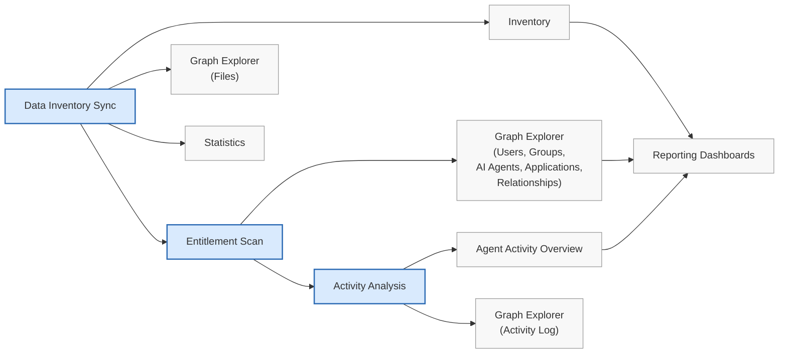

# Viewing Hyperdrive data in Securiti

**Scenario**

As a Data Security Officer, you need to investigate files, user permissions, and AI agent activities discovered across your Hyperdrive-enabled data systems. Finding the right information manually across different pages can slow investigations and make it difficult to know which scans provide the data you need. For example, while reviewing a SharePoint incident, you need to analyze file metadata, verify user access, and examine recent activity. This article helps you quickly identify where each type of scan result appears, so you can access the right information faster and investigate with confidence.

Securiti uses multiple scan types to discover data, analyze access permissions, and monitor activities across your connected Hyperdrive data systems. Each scan contributes different information and populates different areas of Securiti.

This article covers the available scan types and the pages where you can view results. For connector-specific guidance, see the table at the end of this article.

## Prerequisites

Before you can view Hyperdrive data, confirm the following:

- You have configured and connected a supported Hyperdrive data system.
- You have completed the required Hyperdrive scans.

For more information, see [Hyperdrive data systems](/latest/docs/data-systems).

## Hyperdrive data scans

After configuring a Hyperdrive-enabled data system connector and running the relevant scans, Securiti surfaces the results across the Data Command Graph and Dashboards.

Hyperdrive scans build on one another. Run the scans in the recommended order to populate inventory, access intelligence, activity insights, and dashboards, as shown below.

1. Data Inventory Sync
2. Entitlement Scan
3. Activity Analysis

The following table summarizes each Hyperdrive scan and the data it collects.

| Scan | Collected data |
| --- | --- |
| Data Inventory Sync | Files metadata and inventory information |
| Hyperdrive Access Intelligence (Entitlement scans and Activity Analysis) | - Users, groups, AI agents, applications, permissions, and relationships - User, AI agent, and application activities |

## Where to view Hyperdrive data

Use the table below to understand where to view your Hyperdrive data.

| Page | Use case |
| --- | --- |
| Connector Statistics page | From the left navigation of your Hyperdrive data system, click **Statistics** tab. - Monitor Data Inventory Sync progress. - Review inventory and cataloging metrics. - Track scan performance and processing rates. - View connector-specific inventory statistics. |
| Inventory | - View discovered files and assets for a Hyperdrive-enabled data system. - Review inventory metadata collected during **Data Inventory Sync** with the **Files** entity. - Explore asset properties, classifications, and related entities. - Connect assets and apply tags for organization and governance. - View the Hyperdrive Access Intelligence results, such as User, AI agent, and application activities using the **Activity Log** entity. |
| Graph Explorer | - Explore relationships between files, users, AI agents, groups, and applications. - Build custom graph queries. - Review inventory metadata using **Files** entity. - Analyze **Activity Log** events. - Investigate user and AI agent interactions. |
| Graph Reporting Dashboards | - Analyze inventory, security, and AI security insights. - Monitor trends across your data estate. - Visualize Hyperdrive data through system dashboards and custom dashboards. - Create custom reports using Graph Explorer queries. You can use the following Graph Reporting Dashboards to view scan results for Hyperdrive data systems: - [Microsoft 365 Data and AI Security dashboard](/latest/docs/microsoft-365-data-and-ai-security-dashboard) for M365 data systems - [Unstructured Data Overview](/latest/docs/unstructured-data-overview-dashboard) for other supported data systems, such as Amazon S3. - [Custom dashboards](/latest/docs/managing-dashboards) depending on your business use case |
| Agent Activity Overview dashboard | - Investigate user, AI agent, and application activities, with the **Activity Log** entity. - Analyze events using the **Timeline** view. - Review detailed activity records in the **Audit Log** view. - Filter activities by connector, actor, activity type, or time. |

## Connector-specific scan results

For connector-specific entity details, column definitions, and step-by-step guidance, see the following articles:

| Hyperdrive data system | Supported scans | Help article |
| --- | --- | --- |
| Amazon S3 | Data Inventory Sync | Viewing Hyperdrive scan results for Amazon S3 |
| Azure Blob Storage | Data Inventory Sync | Viewing Hyperdrive scan results for Azure Blob Storage |
| Google Cloud Storage | Data Inventory Sync | Viewing Hyperdrive scan results for Google Cloud Storage |
| Microsoft 365 OneDrive | - Data Inventory Sync - Hyperdrive Access Intelligence (Entitlement scans and Activity Analysis) | [Viewing Hyperdrive scan results for OneDrive](/latest/docs/viewing-hyperdrive-scan-results-for-onedrive) |
| Microsoft 365 Outlook | - Data Inventory Sync - Hyperdrive Access Intelligence (Entitlement scans and Activity Analysis) | [Viewing Hyperdrive scan results for Outlook](/latest/docs/viewing-hyperdrive-scan-results-for-outlook) |
| Microsoft 365 SharePoint Online | - Data Inventory Sync - Hyperdrive Access Intelligence (Entitlement scans and Activity Analysis) | [Viewing Hyperdrive scan results for SharePoint](/latest/docs/viewing-hyperdrive-scan-results-for-sharepoint) |
| Microsoft 365 Teams | - Data Inventory Sync - Hyperdrive Access Intelligence (Entitlement scans and Activity Analysis) | [Viewing Hyperdrive scan results for Teams](/latest/docs/viewing-microsoft-teams-scan-results) |
| NFS | Data Inventory Sync | Viewing Hyperdrive scan results for NFS |
| SMB | Data Inventory Sync | Viewing Hyperdrive scan results for SMB |
